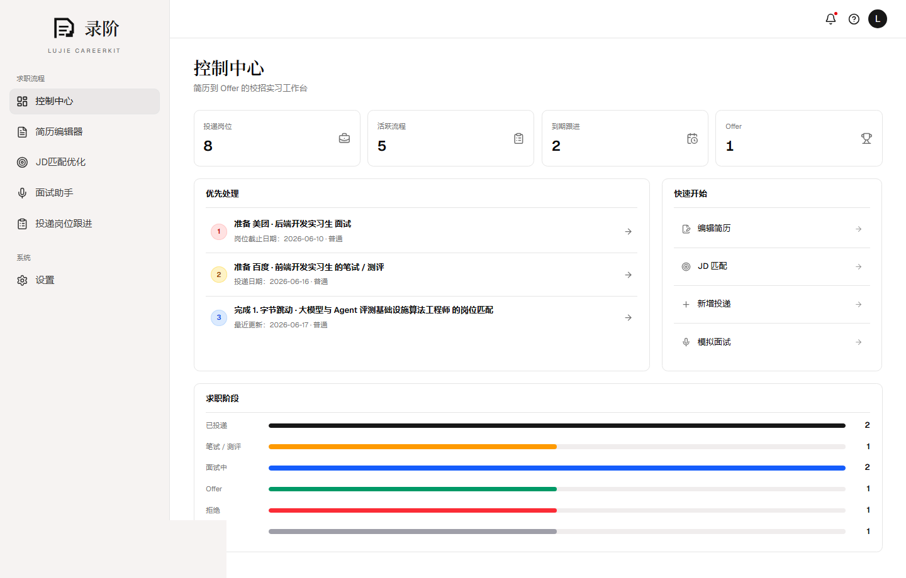

<div align="center">

# Career Wiki Agent

A local-first career workspace: it turns your projects and evidence into an approved, JD-tailored resume through an explicit eleven-state workflow — and never applies anywhere for you.

一个本地优先的求职工作台：把项目与证据整理成一份经过审核、按 JD 定制的简历，全程走一条明确的十一状态工作流——但从不替你去投递。

[](LICENSE)
[](package.json)
[](package.json)
[](prisma/schema.prisma)
[](.env.template)



<sub>Screenshot shipped in <code>public/images/</code>, captured from a local run with demo data; it is not regenerated by CI.<br/>截图来自 <code>public/images/</code>，是本机演示数据下的一次运行，不由 CI 重新生成。</sub>

</div>

> **How to read this page · 怎么读这页**
> English first, then the same content in Chinese — not a summary, not a separate half. Tables keep both languages in one cell.
> 每段英文在前，同一内容的中文紧跟在后；不是摘要，也没有单独的「中文版」。表格把两种语言放进同一格。

---

## At a glance · 一眼看懂

| | |
|---|---|
| **Problem<br/>问题** | Everyone rewrites the same resume for every JD and then cannot say which claim in it has evidence behind it.<br/>每个人都在为每条 JD 重写同一份简历，然后说不清里面哪句话有证据撑着。 |
| **Fix<br/>做法** | Projects, skills, JD analysis, project-fit scoring, evidence review, tailoring and export are eleven gated states; every transition and evidence change is audited.<br/>项目、技能、JD 分析、匹配打分、证据审核、定制与导出是十一个带门禁的状态；每次状态流转与证据改动都进审计日志。 |
| **Cost<br/>代价** | Node 20.9+, `npm ci`, one local SQLite file, one encryption secret. AI features need an OpenAI-compatible key; the rest works without one.<br/>Node 20.9+、`npm ci`、一个本地 SQLite 文件、一个加密密钥。AI 功能需要一个兼容 OpenAI 的 key，其余功能不需要。 |
| **Not<br/>不是** | Not a job-board crawler and not an auto-applier: no login automation, no cookie or proxy handling, no captcha bypass, no HR messaging.<br/>不是招聘站爬虫，也不自动投递：没有登录自动化、不处理 Cookie 与代理、不绕验证码、不代发 HR 消息。 |

## Where this comes from · 这份代码从哪来

This repository is a snapshot of **[LuJie CareerKit](https://github.com/Chozzc/Lujie-Careerkit)** (Apache-2.0, © 2026 Chozzc) with an added local **Career Wiki Agent** line on top. `MEMORY.md` records the provenance: the tree was restored on 2026-07-08 from the public snapshot through GitHub tree/raw downloads after `git clone` kept failing on pack transfer, then extended in this repository.

这个仓库是 **[LuJie CareerKit](https://github.com/Chozzc/Lujie-Careerkit)**（Apache-2.0，© 2026 Chozzc）的快照，上面加了一条本地 **Career Wiki Agent** 线。来源记在 `MEMORY.md`：2026-07-08 `git clone` 反复在 pack 传输上失败，于是用 GitHub tree/raw 下载复原了公开快照，然后在本仓库里继续扩展。

What that means in practice:

这在实践上意味着：

- The package is still named `lujie-careerkit` at version `0.1.6`, and `NOTICE` carries the upstream attribution plus the JadeAI notice. Keep both if you fork again.<br/>包名仍是 `lujie-careerkit`、版本 `0.1.6`，`NOTICE` 里有上游署名和 JadeAI 声明。再分叉请一并保留。
- `README.zh-CN.md` is the upstream split-language README. This page replaces it as the entry point for this repository; it is left untouched.<br/>`README.zh-CN.md` 是上游那套「中英分两半」的 README。本页取代它作为本仓库入口，那个文件保持原样。
- `.github/workflows/docker-image.yml` still publishes to `ghcr.io/chozzc/lujie-careerkit`, the upstream namespace. From this fork it needs `IMAGE_NAME` changed before it can publish anything, which is why there is no CI badge on this page.<br/>`.github/workflows/docker-image.yml` 仍然发布到上游命名空间 `ghcr.io/chozzc/lujie-careerkit`。在这个 fork 里要先改 `IMAGE_NAME` 才可能发布出东西，所以本页不挂 CI 徽章。

## The problem · 问题在哪

A tailored resume is a chain of claims, and every link is easy to fake by accident. The workflow exists to make each link checkable, in this order:

一份定制简历是一条主张链，每一环都很容易不小心变成编造。这条工作流的目的就是让每一环都能被核对，顺序如下：

```text
profile_ready → projects_ready → skills_ready → jd_imported
→ project_fit_reviewed → evidence_reviewed → resume_drafted
→ diff_reviewed → resume_approved → exported → archived
```

`src/lib/career-wiki/workflow/state-machine.ts` defines exactly these transitions, and every non-`archived` state can jump to `archived` when a user gives up. A transition is refused unless the guard for it is satisfied — profile completeness, project bank count, skill matrix count, JD availability, project-fit result, verified evidence, draft, approved version, export log.

`src/lib/career-wiki/workflow/state-machine.ts` 里写的就是这些跳转，除 `archived` 外的每个状态都可以在用户放弃时直接进 `archived`。守卫不满足就不许跳——守卫包括资料完整度、项目库数量、技能矩阵数量、JD 是否可用、匹配结果、已核实证据、草稿、已批准版本、导出记录。

Without that chain, "tailor my resume to this JD" silently rewrites claims that nothing backs. With it, the rewrite has to name the evidence first.

没有这条链，「按这条 JD 改一下简历」就会静默改写出没有东西支撑的主张。有了这条链，改写就必须先点名证据。

## The idea · 思路

Five nouns, each with one rule you can check in code:

五个名词，每个都有一条能在代码里查的规则：

| Noun · 名词 | Path · 位置 | Rule · 规则 |
|---|---|---|
| **Project Fit** | `src/lib/career-wiki/project-fit/` | Four sub-scores — domain, evidence, keyword, risk — combined into one `fit_score`; evidence below 30 forces `needs_manual_review`.<br/>四个子分：领域、证据、关键词、风险，合成一个 `fit_score`；证据分低于 30 强制转为 `needs_manual_review`。 |
| **Override** | `classifier.ts` | A manual override is recorded with its reason and appended to `risk_warnings` instead of silently replacing the score.<br/>人工覆盖会连同理由一起记录并追加进 `risk_warnings`，而不是悄悄替换分数。 |
| **Evidence** | `src/lib/career-wiki/evidence.ts` | Create, update and delete all land in the audit log; payloads are sanitized and secrets are redacted rather than stored.<br/>新增、修改、删除都进审计日志；载荷先净化，密钥做脱敏而不是存下来。 |
| **Render** | `src/lib/career-wiki/renderers/` | Five renderers — docx, html, json, markdown, pdf — over three templates: `ats`, `compact`, `modern`.<br/>五个渲染器——docx、html、json、markdown、pdf——加三套模板：`ats`、`compact`、`modern`。 |
| **Fallback** | `src/lib/ai/tasks.ts` | Every AI task declares a fallback, so interview questions, interview report and generic tasks still return something when no key is set.<br/>每个 AI 任务都声明 fallback，所以没配 key 时面试题、面试报告和通用任务仍能返回结果。 |

The one test that tells you whether the workflow is real and not decoration:

一条能判断这条工作流是真的还是装饰的测试：

```bash
npx vitest run src/lib/career-wiki/rules.test.ts src/lib/career-wiki/one-click-flow.test.ts
```

If the guards were cosmetic, those two suites could not exist without stubbing the state machine.

如果守卫只是摆设，这两个套件在不伪造状态机的前提下写不出来。

## Capabilities · 能力清单

| Surface · 入口 | What it does · 做什么 | Verify · 怎么验证 |
|---|---|---|
| **Career Wiki app** | Eight `page.tsx` entries under `/career-wiki/*`: dashboard, workflow, evidence review, audit, quick start, resume versions, section pages and the version preview.<br/>`/career-wiki/*` 下八个 `page.tsx`：看板、工作流、证据审核、审计、快速开始、简历版本、分区页和版本预览。 | `src/app/career-wiki/`; `npm run dev` then open `/career-wiki/dashboard`. |
| **Resume workbench** | Structured editor with drag-and-drop sections, templates and themes; exports PDF, PNG and editable DOCX.<br/>结构化编辑器，区块可拖拽，支持模板与主题；导出 PDF、PNG 和可编辑 DOCX。 | `src/components/editor/`, `src/lib/resume-*`. |
| **JD matching and tailoring** | Parse a JD, reorder emphasis, produce a tailored version and a before/after diff.<br/>解析 JD、调整重点、产出定制版本与前后差异。 | `src/app/api/ai/resume-tailor/`; `src/lib/career-wiki/resume-tailor.ts`. |
| **Application tracking** | Companies, roles, sources, stages, deadlines, follow-up dates, priorities, notes, JD text and the resume version used.<br/>公司、岗位、来源、阶段、截止、跟进日期、优先级、备注、JD 正文和所用的简历版本。 | Dashboard counters are derived from these rows; see the FAQ in the original README.<br/>看板数字由这些行算出，口径见既有 README 的 FAQ。 |
| **Interviews** | Question generation from resume plus JD, answer drafts, and an AI review report you can revisit.<br/>按简历加 JD 生成问题、保存回答草稿、可回看的 AI 复盘报告。 | `src/lib/ai/interview-tasks.ts`. |
| **Obsidian export** | Writes the career wiki out as Markdown into `CAREER_VAULT_PATH`, timestamping filenames instead of overwriting.<br/>按 `CAREER_VAULT_PATH` 把职业 wiki 写成 Markdown，文件名冲突时加时间戳而不是覆盖。 | `src/lib/career-wiki/obsidian-export.ts`. |
| **Ops scripts** | `career:healthcheck`, `career:integrity`, `career:backup` over `scripts/career-wiki-*.ts`.<br/>`career:healthcheck`、`career:integrity`、`career:backup`，实现在 `scripts/career-wiki-*.ts`。 | `npm run career:healthcheck`. |

## Quickstart · 快速开始

### Requirements · 环境要求

Node.js 20.9 or later. Chrome or Edge if you want browser speech input. AI features need an OpenAI-compatible provider; nothing else does.

需要 Node.js 20.9 以上。要用浏览器语音输入就用 Chrome 或 Edge。AI 功能需要一个兼容 OpenAI 的服务商，其余功能不需要。

### 1. Install · 安装

```bash
git clone https://github.com/songconmaisaix31-design/career-wiki-agent.git
cd career-wiki-agent
npm ci          # runs prisma generate via postinstall · postinstall 里会跑 prisma generate
```

### 2. Configure · 配置

```bash
cp .env.template .env.local
node -e "console.log(require('crypto').randomBytes(32).toString('hex'))"
```

```powershell
Copy-Item .env.template .env.local
node -e "console.log(require('crypto').randomBytes(32).toString('hex'))"
```

Put the generated value into `.env.local` as `LUJIE_SETTINGS_SECRET`. The template also carries `DATABASE_URL` (a local SQLite file), `CAREER_VAULT_PATH`, `MARKITDOWN_COMMAND`, `OPENAI_MODEL` and `NODE_ENV`.

把生成的值写进 `.env.local` 的 `LUJIE_SETTINGS_SECRET`。模板里还有 `DATABASE_URL`（本地 SQLite 文件）、`CAREER_VAULT_PATH`、`MARKITDOWN_COMMAND`、`OPENAI_MODEL` 和 `NODE_ENV`。

The template file is `.env.template`, not `.env.example` — the clone step in the older README pointed at a file that is not in this tree.

模板文件是 `.env.template`，不是 `.env.example`——旧 README 里那条复制命令指向的文件在这个树里不存在。

### 3. Run · 运行

```bash
npm run dev        # next dev on http://localhost:3000 · 打开 http://localhost:3000
npm test           # vitest run · 跑 vitest
```

The app creates the local schema and demo rows on first use. AI keys are entered on the in-app Settings page, encrypted with `LUJIE_SETTINGS_SECRET` before being written to SQLite.

首次运行会建本地表并写入演示数据。AI key 在应用内的设置页填写，写进 SQLite 前用 `LUJIE_SETTINGS_SECRET` 加密。

Docker alternative, same data volume:

Docker 方式，数据卷一样：

```bash
docker run -d --name career-wiki-agent \
  -p 3000:3000 \
  -v lujie-data:/data \
  -e LUJIE_SETTINGS_SECRET="replace-with-a-long-random-string" \
  ghcr.io/chozzc/lujie-careerkit:latest   # upstream image, built before the Career Wiki line · 上游镜像，早于 Career Wiki 这条线
```

The image above is the upstream one. It does not contain the `/career-wiki/*` routes from this repository; build locally (`docker compose up --build`) to get them.

上面这个镜像是上游的，不包含本仓库的 `/career-wiki/*` 路由；要这些路由请本地构建（`docker compose up --build`）。

## Documentation · 文档

| Doc · 文档 | Read it when · 什么时候读 |
|---|---|
| [docs/architecture/career-wiki-workflow.md](docs/architecture/career-wiki-workflow.md) | You need the state machine, the guard list and the audit coverage.<br/>需要状态机、守卫清单与审计覆盖范围。 |
| [docs/operations/career-wiki-maintenance.md](docs/operations/career-wiki-maintenance.md) | You are running healthcheck, integrity or backup.<br/>要跑健康检查、完整性检查或备份。 |
| [docs/qa/career-wiki-agent-e2e-checklist.md](docs/qa/career-wiki-agent-e2e-checklist.md) | You are checking the flow end to end by hand.<br/>要手工端到端走一遍。 |
| [docs/frontend/design-system.md](docs/frontend/design-system.md) | You are touching the app shell, tokens or shared states.<br/>要改应用外壳、token 或共享状态。 |
| [docs/releases/v0.4-frontend-ux-overhaul.md](docs/releases/v0.4-frontend-ux-overhaul.md) | You want to know what the local line changed, release by release.<br/>想看这条本地线每个版本改了什么。 |
| [docs/research/browser-assisted-job-application-evaluation.md](docs/research/browser-assisted-job-application-evaluation.md) | You are about to ask for auto-apply and want to read why it is excluded.<br/>想加自动投递，先看为什么被排除。 |
| [docs/goals/](docs/goals/) | You want the original goal documents behind each feature.<br/>想看每个功能背后的目标文档。 |
| [MEMORY.md](MEMORY.md) | You need the provenance and the decisions carried between sessions.<br/>需要来源记录与跨会话决策。 |

## Repository layout · 仓库结构

```text
career-wiki-agent/            467 files excluding .git · 不含 .git 共 467 个文件
├── src/app/                  Next.js routes: app pages, /career-wiki/*, /api/*
├── src/components/           editor, match, interview, pipeline, career-wiki UI
├── src/lib/career-wiki/      workflow, project-fit, evidence, renderers, ops
├── src/lib/ai/               provider registry, settings, task fallbacks
├── src/stores/               resume editor state (zustand)
├── prisma/schema.prisma      SQLite schema; data lives in prisma/dev.db
├── scripts/                  career-wiki healthcheck, integrity, backup
├── tests/fixtures/           resume render schema fixtures · 渲染 schema 夹具
├── public/images/            the 10 README screenshots · README 用的 10 张截图
├── docs/                     architecture, goals, operations, qa, releases, research
├── messages/                 next-intl message catalogues · next-intl 文案
└── third-party/              JadeAI license notice · JadeAI 许可声明
```

## Status · 状态

Snapshot, not a development trail: `git log --oneline` shows a single merge commit. The upstream product line stopped at `v0.1.6`; the local line continues as `v0.2` → `v0.4` in `docs/releases/`, with 48 vitest files in the tree today.

这是快照，不是开发轨迹：`git log --oneline` 只有一条合并记录。上游产品线停在 `v0.1.6`；本地这条线按 `docs/releases/` 里的 `v0.2` → `v0.4` 继续，当前树里有 48 个 vitest 文件。

What is not there, stated instead of discovered later. These are product non-goals, not a to-do list:

不存在的部分写在这里，而不是等你踩到。这些是产品层面的非目标，不是待办清单：

不存在的部分写在这里，而不是等你踩到：

- **No automatic application, by design.** No crawling, login automation, cookie management, proxy pools, captcha bypass or HR messaging. This is a product decision recorded in the goal documents, not a missing weekend feature.<br/>**按设计不做自动投递。** 没有爬虫、登录自动化、Cookie 管理、代理池、验证码绕过或代发 HR 消息。这是目标文档里写下的产品决定，不是差一个周末的功能。
- **The CI workflow targets another namespace.** `docker-image.yml` publishes `ghcr.io/chozzc/lujie-careerkit`; from this fork nothing is published until `IMAGE_NAME` changes. No CI badge here on purpose.<br/>**CI 工作流指向别人的命名空间。** `docker-image.yml` 发布的是 `ghcr.io/chozzc/lujie-careerkit`；在这个 fork 里不改 `IMAGE_NAME` 什么也发不出去。所以这里故意不挂 CI 徽章。
- **The Docker image command installs the upstream build.** The published tag predates the Career Wiki line and has no `/career-wiki/*` routes.<br/>**Docker 命令装的是上游构建。** 那个 tag 早于 Career Wiki 这条线，没有 `/career-wiki/*` 路由。
- **AI output is not verified here.** Quality depends on the provider you configure; every test in the tree runs offline against fixtures or fallbacks.<br/>**这里的 AI 输出没有被验证。** 质量取决于你配的服务商；树里所有测试都离线跑夹具或 fallback。
- **Screenshots are mixed-format.** `docs/frontend/screenshots/*.png` are actually JPEG bytes with a `.png` extension, so they may not render everywhere; the header image above uses a real PNG from `public/images/`.<br/>**截图格式不统一。** `docs/frontend/screenshots/*.png` 实际是 JPEG 字节挂了 `.png` 后缀，可能在某些地方显示不出来；上面这张头图用的是 `public/images/` 里的真 PNG。
- **Nothing here was built or run by this rewrite.** Commands are transcribed from `package.json`, `.env.template` and the repo's own docs.<br/>**这次改写没有构建也没有运行。** 命令来自 `package.json`、`.env.template` 和仓库自己的文档。

## License · 许可

Apache-2.0. Upstream © 2026 Chozzc, and this snapshot keeps that attribution; third-party notices are in [NOTICE](NOTICE), the full text in [LICENSE](LICENSE).

Apache-2.0，上游 © 2026 Chozzc，本快照保留该署名；第三方声明在 [NOTICE](NOTICE)，完整文本在 [LICENSE](LICENSE)。
