# Career Wiki Workflow Architecture

## Intent

The workflow layer makes the local pre-application review path explicit. It does not automate job applications or external recruiting platforms.

## State Machine

```mermaid
flowchart LR
  A["profile_ready"] --> B["projects_ready"]
  B --> C["skills_ready"]
  C --> D["jd_imported"]
  D --> E["project_fit_reviewed"]
  E --> F["evidence_reviewed"]
  F --> G["resume_drafted"]
  G --> H["diff_reviewed"]
  H --> I["resume_approved"]
  I --> J["exported"]
  J --> K["archived"]
```

Every state can be archived through an explicit transition when the state machine allows it.

## Guard Sources

- Career Profile completeness
- Project Bank count
- Skill Matrix count
- JD test availability
- Project Fit result availability
- Verified evidence availability
- Resume Tailor draft availability
- Approved resume version availability
- Export log availability

## Audit Coverage

Audit logs cover:

- Evidence create / update / delete
- Project Fit run
- Project Fit override
- Resume version status change
- Approved final resume export
- Workflow transition

Audit payloads are sanitized before storage. Secrets are redacted rather than preserved.

## Evidence Quality Review

Evidence Quality Review detects:

- Draft evidence
- Weak source context
- Short evidence content
- Duplicate evidence
- Project Fit insufficient evidence

Open high-severity items block resume approval. Draft or rejected evidence cannot support final resume approval.

## Sensitive Guards

The centralized sensitive scan blocks:

- API key-like values
- Cookie values
- token values
- password / secret / authorization values
- private key blocks
- recruiting platform account credentials

Final resume content additionally blocks:

- `production-ready`
- `Missing Evidence`
- `missing_evidence`
- ReviewFlow AI status claims that do not preserve WIP / prototype / semi-finished wording
